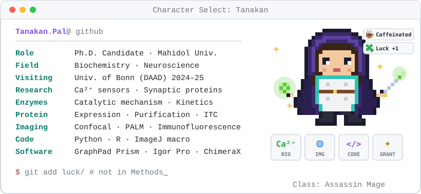
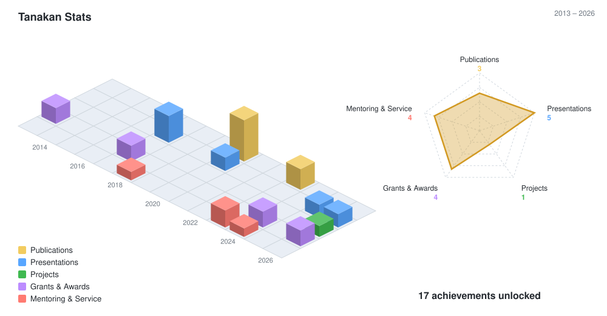
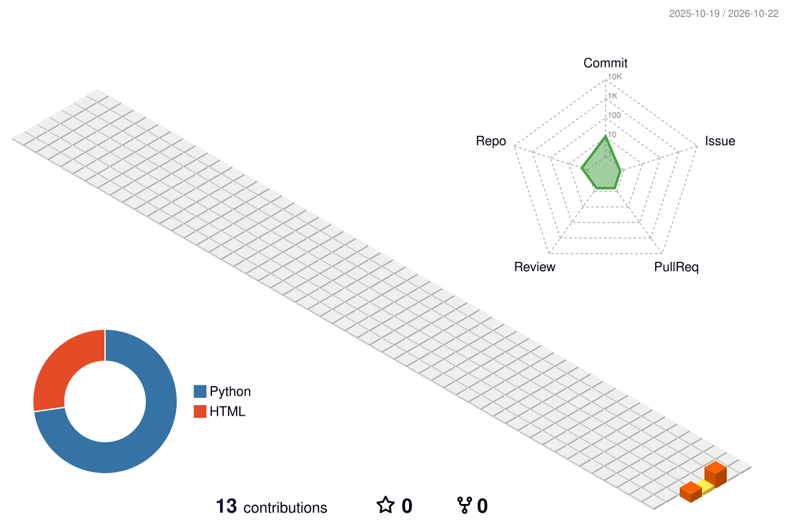

  <picture>
    <source media="(prefers-color-scheme: dark)" srcset="id_badge_dark.svg">
    
  </picture>

  
  
  
  

---

### 👋 About Me

I'm a Ph.D. student in Biochemistry at Mahidol University (Thailand), working in the Khvotchev Lab with Dr. Mikhail Khvotchev. I study how calcium sensors control SNARE-mediated exocytosis, building on a background in enzyme mechanisms and transient kinetics. This GitHub holds my image-analysis tools (Fiji macros, Python) for confocal microscopy.

- ✈️ **Research stay:** DAAD fellow, University of Bonn (2024–25), PALM super-resolution imaging of synaptic proteins in neurons
- 🏅 **Highlight:** selected delegate, Global Young Scientists Summit (GYSS) 2026, Singapore
- 💬 **Ask me about:** enzyme mechanisms & kinetics, protein structure–function

---

### 🧰 Skills

| **Protein & Enzymes** | **Cell & Molecular** | **Imaging** | **Computational** |
|:---:|:---:|:---:|:---:|
|       |       |     |         |

---

### 📄 Publications

<!-- PUBLICATIONS:START -->
- **Paladkong T.**, Pimviriyakul P., Phonbuppha J., Maenpuen S., Chaiyen P., Tinikul R. (2022). Mechanistic roles of the neighbouring cysteine in enhancing nucleophilicity of catalytic residue in a two‐cysteine succinic semialdehyde dehydrogenase. *The FEBS Journal* 290: 2449–2462. [doi:10.1111/febs.16640](https://doi.org/10.1111/febs.16640)
- The effect of additives on bacterial luciferase activity in complete culture media conditions (2020). *PACCON 2020*.
-  (2020). Bacterial luciferase: Molecular mechanisms and applications. *The Enzymes*: 427–455. [doi:10.1016/bs.enz.2020.06.001](https://doi.org/10.1016/bs.enz.2020.06.001)
<!-- PUBLICATIONS:END -->

---

### 🎤 Presentations

- **2026** · Global Young Scientists Summit (GYSS), Singapore  
  *Calcium binding to C2B domain drives oligomerization in neuronal Copine*
- **2025** · Horizons in Molecular Biology Symposium, Göttingen  
  *Calcium-dependent Copine-6 homo-oligomerization: a possible mechanism for modulating SNARE and phospholipid binding*
- **2020** · PACCON 2020, Thailand  
  *Additives effect on bacterial luciferase activity isolated from Vibrio campbellii in complete culture media conditions*

---

### 🎮 Tanakan Stats

<picture>
  <source media="(prefers-color-scheme: dark)" srcset="research-city-dark.svg">
  
</picture>

GitHub City (code activity)

<picture>
  <source media="(prefers-color-scheme: dark)" srcset="profile-3d-contrib/profile-night-view.svg">
  
</picture>

---

### 🎓 Education & Grants

- 🎓 Ph.D. Biochemistry (International Program), Mahidol University, 2021–present
- 🇩🇪 DAAD one-year research grant, University of Bonn, 2024–25
- 🎓 M.Sc. Biochemistry (International Program), Mahidol University, 2017–2021
- 🎓 B.Sc. Biology (Second Class Honors), Mahidol University, 2013–2017
- 🏅 Science Achievement Scholarship of Thailand (SAST), 2013–2024

---

### 📂 Projects

| Project | Description | Stack |
|---|---|---|
| **oir-to-figure** | Fiji + Python pipeline for the Khvotchev Lab: raw Olympus .oir → insets, straightened neurites, slide deck. Built by Tanakan Paladkong (NAT), 2026. *Code will be released upon publication.* | `ImageJ Macro` `Python` |

---

<i>Raw data in, honest figures out. 🧪</i>

